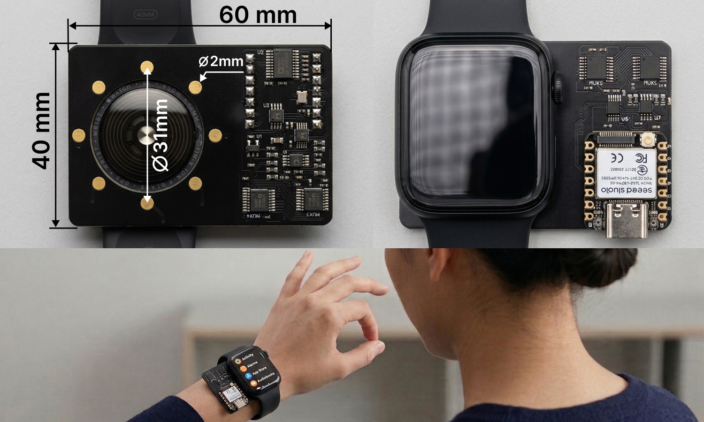

# EITWatch hardware

Open hardware and firmware for **EITWatch**: a smartwatch-back planar Electrical Impedance Tomography (EIT) system for hand gesture sensing.



Eight gold-plated disk electrodes sit in a 31 mm ring on a 40 mm × 60 mm PCB. The electrode ring fits a standard 40 mm watch case back; a 20 mm board extension holds the discrete analog front end. A Seeed XIAO ESP32 module plugs into dual 1×7 headers and sequences a multi-depth injection schedule (35 impedance channels per frame).

This release accompanies the paper:

> Liu, Alam, and Ahuja. *EITWatch: Smartwatch-Integrated Planar Electrical Impedance Tomography for Hand Gesture Recognition.* UIST 2026.

## Repository layout

```text
hw/
├── README.md                 # this file
├── altium/                   # Altium Designer project sources
├── bom/                      # bill of materials
├── docs/                     # overview figure, schematic PDF, STEP model
├── fabrication/gerber/       # Gerber + NC drill for PCB fab
└── firmware/                 # ESP-IDF firmware (XIAO ESP32-C3)
```

| Path | Contents |
|------|----------|
| [`altium/`](altium/) | Editable schematic, PCB, and libraries (`EITWatch.PrjPcb`) |
| [`docs/overview.png`](docs/overview.png) | Prototype overview figure |
| [`docs/schematic.pdf`](docs/schematic.pdf) | Printable schematic |
| [`docs/eitwatch.step`](docs/eitwatch.step) | 3D board model |
| [`fabrication/gerber/`](fabrication/gerber/) | Fabrication outputs (copper, mask, paste, silkscreen, outline, drill) |
| [`bom/BOM.csv`](bom/BOM.csv) | PCB BOM (passives + ICs; MCU module and electrodes are off-board) |
| [`firmware/`](firmware/) | Acquisition firmware and host-side helper scripts |

## System overview

| Item | Spec |
|------|------|
| Board size | 40 mm × 60 mm |
| Electrodes | 8 × Ø2 mm gold-plated stainless steel disks on a Ø31 mm ring (~11.9 mm adjacent spacing) |
| Sensing footprint | Fits a 40 mm watch case back; AFE occupies the remaining 20 mm |
| Excitation | AD5930 sinusoid at 50 kHz; ADA4841 V-to-I; ~1 mA peak-to-peak (AD5270-set) |
| Sensing | AD8220 instrumentation amp + AD5270 gain; AD7450 12-bit ADC |
| Switching | 4 × ADG738 8-channel matrix switches |
| Host MCU | Seeed XIAO ESP32-C3 on headers `P2` / `P3` (firmware in this repo targets `esp32c3`) |
| Frame rate | ~48 Hz for the 35-channel multi-depth schedule |
| Stackup (Gerber export) | 6 copper layers: `GTL`, `G1`–`G4`, `GBL` |

### Key ICs

| Designator | Part | Role |
|------------|------|------|
| U2 | AD5930YRUZ | Waveform generator |
| U5 | ADA4841-2YRMZ | Voltage-to-current drive |
| U4, U6 | AD5270BRMZ-100 | Digital pots (drive current / sense gain) |
| U3, U7 | AD8220ARMZ | Instrumentation amplifiers |
| U8 | AD7450BRZ | 12-bit SPI ADC |
| MUX1–MUX4 | ADG738BRUZ | Electrode matrix switches |
| U1 | TLV73325PDBVT | 2.5 V regulator |
| OS1 | ECS-2520MV-500-BL-TR | 50 MHz oscillator |

Full line items are in [`bom/BOM.csv`](bom/BOM.csv). The BOM does **not** include the XIAO module, watch case, strap, or the eight disk electrodes (those are mechanical / off-board parts).

## Fabrication

### PCB

1. Zip `fabrication/gerber/` (include the `drill/` folder).
2. Order a **6-layer** board matching the Gerber stackup below (or re-export from Altium if you change the stackup).
3. Suggested defaults for prototype houses (JLCPCB / PCBWay style): 1.6 mm thickness, 1 oz copper, ENIG finish on electrode pads if you plate the disks separately or solder them to pads.
4. Review silkscreen and keep-out against your watch case before committing a panel.

#### Gerber layer map

| File | Layer |
|------|--------|
| `main.GTL` | Top copper (Layer 1) |
| `main.G1` | Inner Layer 2 |
| `main.G2` | Inner Layer 3 |
| `main.G3` | Inner Layer 4 |
| `main.G4` | Inner Layer 5 |
| `main.GBL` | Bottom copper (Layer 6) |
| `main.GTS` / `main.GBS` | Top / bottom solder mask |
| `main.GTP` / `main.GBP` | Top / bottom paste |
| `main.GTO` / `main.GBO` | Top / bottom silkscreen |
| `main.GM` | Board outline |
| `drill/main-Plated.TXT` | Plated NC drill |

### Assembly notes

- Populate the mixed-signal AFE on the top side; electrodes face the skin on the bottom.
- Mount the eight Ø2 mm gold-plated stainless disks flush so the watch-back contact plane is even.
- Seat a **Seeed XIAO ESP32-C3** on headers `P2`/`P3` with the orientation matching the silkscreen and [`firmware/docs/esp32-pin-map.png`](firmware/docs/esp32-pin-map.png).
- Power and bring-up: use the firmware hardware-test path before full scanning (see [`firmware/README.md`](firmware/README.md)).

### Editing the design

Open [`altium/EITWatch.PrjPcb`](altium/EITWatch.PrjPcb) in Altium Designer. Main sources:

- `main.SchDoc` – primary schematic
- `AC_sch.SchDoc` – analog / related sheet
- `main.PcbDoc` – PCB layout
- `*.SchLib` / `*.PcbLib` – schematic and footprint libraries
- `PCB.OutJob` – output job used to regenerate Gerbers

Re-export Gerbers into `fabrication/gerber/` after layout changes.

## Firmware

Firmware lives in [`firmware/`](firmware/) (ESP-IDF v5.2+). It drives the AD5930, ADG738 muxes, AD5270 pots, and AD7450 ADC, and runs the measurement / calibration application layer under FreeRTOS.

```bash
cd firmware
. $HOME/esp/esp-idf/export.sh   # adjust to your IDF install
idf.py set-target esp32c3
idf.py build
idf.py -p /dev/tty.usbmodemXXXX flash monitor
```

See [`firmware/README.md`](firmware/README.md) for structure, flash steps, and bring-up notes.

**Note:** The accompanying paper text refers to a Seeed XIAO ESP32-S3 for the reported study path. The firmware checked into this folder is configured and pin-mapped for **XIAO ESP32-C3** (`CONFIG_IDF_TARGET=esp32c3`). If you port to S3, update `sdkconfig`, pin macros in `firmware/drivers/board_pins.h`, and re-validate SPI / CS wiring.

## Safety and intended use

This is a research prototype for short-duration, IRB-approved human-subject studies or phantom / water-tank experiments. It injects a small AC current into tissue via skin electrodes.

- Do not use on people with implanted electronic devices (e.g. pacemakers) without appropriate medical / IRB review.
- Do not use as a medical device or for clinical diagnosis.
- Keep injected current and contact quality within the design envelope (~1 mA peak-to-peak at 50 kHz in the paper configuration).
- You are responsible for compliance with local electrical safety and human-subjects rules.

## Citation

If you use this hardware or firmware, please cite the UIST 2026 EITWatch paper (update the BibTeX once the ACM DOI is available):

```bibtex
@inproceedings{eitwatch2026,
  author    = {Liu, Xuanyou and Alam, Novel and Ahuja, Karan},
  title     = {{EITWatch}: Smartwatch-Integrated Planar Electrical Impedance Tomography for Hand Gesture Recognition},
  booktitle = {Proceedings of the 39th Annual ACM Symposium on User Interface Software and Technology},
  series    = {UIST '26},
  year      = {2026},
  publisher = {ACM},
  note      = {Camera-ready; replace with ACM DOI when available}
}
```

## License

Copyright 2026 Xuanyou Liu, Novel Alam, and Karan Ahuja.

| Material | License | File |
|----------|---------|------|
| Hardware (`altium/`, `bom/`, `docs/`, `fabrication/`) | [CERN-OHL-P-2.0](https://ohwr.org/cern_ohl_p_v2.txt) | [`LICENSE.CERN-OHL-P-2.0`](LICENSE.CERN-OHL-P-2.0) |
| Firmware (`firmware/`) | [Apache-2.0](https://www.apache.org/licenses/LICENSE-2.0) | [`firmware/LICENSE`](firmware/LICENSE) |

See [`LICENSE`](LICENSE) for the dual-license summary.

## Acknowledgments

Designed for research on planar wrist-EIT at Northwestern University. Contact: xuanyou@u.northwestern.edu.
